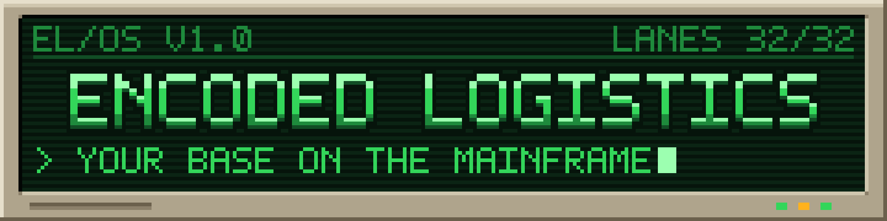

  

  Your base on the mainframe: storage networks and automation with server racks, servers and a scriptable terminal
  operating system. For Minecraft 26.3 on NeoForge.

## About

Encoded Logistics builds your base's storage into a network you run like a mainframe. Cables carry lanes from a
Network Controller to drives, terminals, ports and server racks; autocrafting runs as jobs; and a green-screen Terminal
Desk gives you a whole operating system, with its own command language (ELCL) for programs, scheduled jobs and
triggers.

## Features

- **Networks and storage:** Network Controllers, cables with lanes, and Storage Drives for items, fluids, gases and
  energy, with hot disk and cold tape storage.
- **Terminals:** Access, Fabrication and Handheld Terminals, with search, JEI support and fluid, gas and energy tabs.
- **Autocrafting:** Schematic Encoders, Fabricators, Gateways and Schedulers, including recipes with fluids and gases.
- **Server Racks:** Firewalls, Routers, UPSes, switches, servers, NAS / SAN and Tape Libraries in one multiblock.
- **Wireless:** Access Points, Wireless Bridges and Wireless Ports.
- **The Terminal OS and ELCL:** a green-screen OS on the Terminal Desk, and a command language with an editor,
  compiler, batch jobs, schedules, triggers and database files.
- **The Midrange line:** Midrange Systems with Keypunches, Card Readers, Line Printers, diskettes and printouts.
- **Automation and signals:** the Control Interface, the PLC, Display Panels, Cage Lights, Alarm Strobes and Speakers.

The full list is in [CHANGELOG.md](CHANGELOG.md).

## Requirements

- Minecraft 26.3
- NeoForge 26.3.0.0-beta or later

Optional: [JEI](https://modrinth.com/mod/jei), [Jade](https://modrinth.com/mod/jade) and
[Arcforge](https://github.com/zagdrath/arcforge) 2.5.0 or later, whose machines join a network through the Small
Wireless Bridge.

## Documentation

- [The documentation site](https://zagdrath.dev/encoded-logistics/site): guides for every block, rack device and
  network, the Terminal OS and ELCL, server config and every recipe. Its source is in `docs/site-src` and the built
  site in `docs/site` (open `docs/site/index.html` to read it offline); [rebuilding and publishing it](docs/site-src/PUBLISHING.md).
- [ELCL design notes](docs/elcl)
- [Releasing](docs/RELEASING.md)

## Sounds

All of the mod's sounds are original: they were synthesised for Encoded Logistics, with no recorded samples or
third-party sounds. The scripts in [tools/](tools) generate the Terminal Desk's sounds (`desk_sound.py`) and the
Server Rack's door, console and tape sounds (`rack_sound.py`, `sound3.py`).

## Credits

Speakers decode MP3 files with JLayer 1.0.1 by JavaZOOM, licensed under the GNU Lesser
General Public License 2.1. JLayer is carried inside the mod's jar as its own unmodified jar, and its licence text is
in the mod's jar at `META-INF/licenses/jlayer-LGPL-2.1.txt`.

## License

[MIT](LICENSE). JLayer, carried in the jar, is LGPL 2.1 (see Credits).
